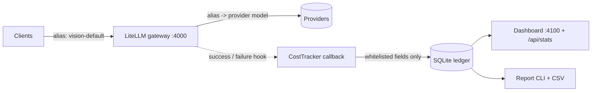
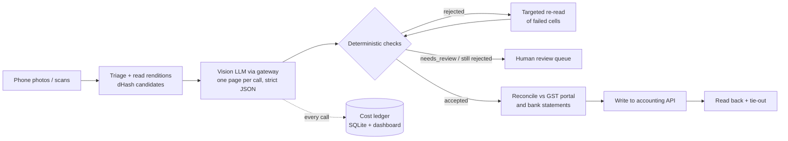

# Handwritten Bill Extraction with LLM Validation and Cost Tracking

Two parts, built together:

1. **Document extraction with deterministic validation.** Turns phone photos of handwritten bills
   into schema-validated records with a vision LLM, checks every record with deterministic rules
   (required fields, arithmetic, GSTIN checksum, amount-in-words), reconciles it against independent
   sources, and only then lets it be posted.
2. **An LLM usage and cost tracker.** Every model call goes through a self-hosted LiteLLM gateway with
   model aliases. A callback records tokens, cache hits, latency, failures and estimated cost per
   alias and provider model into SQLite, with a dashboard, a report CLI and a keyless demo. It
   never stores prompts or identifiers. [Jump to the tracker ↓](#llm-usage-and-cost-tracker)

Built for a small trading business (name withheld) whose newest records existed only as paper.
Real bills, ledgers, identifiers, incidents and business figures are **not** in this repo.
Everything under [`samples/`](samples/) is synthetic and visibly watermarked. Its GSTINs use state
code `00` (which no registration has) and a PAN holder type that doesn't exist, so they cannot
belong to a real taxpayer.

```
$ python run.py validate samples/misread_bill_02.json
samples/misread_bill_02.json: REJECTED
   [error] line_items[1].amount: weight 22.075 x rate 39250 = 866443.75, but amount reads 806443.75
   [error] total: line amounts sum to 806443.75, total reads 866443.75
   [error] buyer_gstin: checksum: expected 'H', got '2'
```
That file is a plausible-looking extraction of [`bill_02.jpg`](samples/bills/bill_02.jpg) with two
typical handwriting misreads: a `6` read as `0` in the amount, and the GSTIN's last character read
as `2`. Neither would be noticed by eye in a spreadsheet. Both are caught without looking at the
image again.

## LLM usage and cost tracker



```
$ python gateway/demo_traffic.py          # mock traffic through a real LiteLLM Router: no keys, no network
calls 14  (failures 2, error rate 14.3%)
tokens  input 120  cached 0 (0.0%)  output 240
estimated cost $0.002640  (budget $50.00, remaining $50.00)

alias           provider model               calls  fail        in       out      cost $      p50      p95
vision-default  openai/mock-vision-model        10     2        80       160    0.001760    14 ms  2530 ms
cheap-text      openai/mock-text-model           4     0        40        80    0.000880    14 ms    48 ms
```

- **Per call:** alias, provider and provider model, call type, input/cached/output tokens,
  latency, LiteLLM's reported cost, a benchmark cost from a local price table (per model or alias
  via `TRACKER_PRICES_FILE`), and the exception type for failures.
- **Dashboard and report:** totals, error rate, cache share, estimated spend versus a budget
  threshold, a 60-second spend rate, and a per-alias breakdown with p50/p95 latency. CSV export.
- **Privacy by whitelist:** prompts, responses, prompt hashes, users, session ids, keys, API base
  URLs, headers and error messages are never written. Tests push secrets through every one of
  those channels and scan the database *file* for them. Ledgers from the original version are
  migrated and vacuumed so old prompt text is physically removed.
- **Verified against real LiteLLM:** integration tests drive a real `litellm.Router` (mock
  responses) through the callback, both async and sync, success and failure.

**Original vs. improved.** The original tracker (built during the project) already had the
callback, the SQLite ledger, token/latency/dual-cost capture and a basic dashboard. Preparing it
for this repo exposed real defects:
- its async hook sat outside the class, so production traffic was never recorded;
- it stored the provider model where the alias should be;
- its 60-second window counted the whole day;
- it stored prompt previews and request metadata;
- it ignored failures.

All of these are fixed, with tests. Failure tracking, per-alias pricing, the breakdown,
the report and the demo were added. The full record is in
[`docs/cost-tracker.md`](docs/cost-tracker.md#original-version-vs-portfolio-improvements).

## Why this is hard

- Handwritten digits are ambiguous, and **a plausible wrong digit is still a wrong tax figure.**
- Photos are 3000×4000 px and ~6 MB each. Batches hit `HTTP 413` and per-conversation image caps.
- Free-form model output cannot be checked automatically.
- For financial records, the dangerous failure is a **false "yes"**: a wrong document accepted,
  or two different documents reconciled as one.

## Design


# Handwritten Bill Extraction with LLM Validation and Cost Tracking

Two parts, built together:

1. **Document extraction with deterministic validation.** Turns phone photos of handwritten bills
   into schema-validated records with a vision LLM, checks every record with deterministic rules
   (required fields, arithmetic, GSTIN checksum, amount-in-words), reconciles it against independent
   sources, and only then lets it be posted.
2. **An LLM usage and cost tracker.** Every model call goes through a self-hosted LiteLLM gateway with
   model aliases. A callback records tokens, cache hits, latency, failures and estimated cost per
   alias and provider model into SQLite, with a dashboard, a report CLI and a keyless demo. It
   never stores prompts or identifiers. [Jump to the tracker ↓](#llm-usage-and-cost-tracker)

Built for a small trading business (name withheld) whose newest records existed only as paper.
Real bills, ledgers, identifiers, incidents and business figures are **not** in this repo.
Everything under [`samples/`](samples/) is synthetic and visibly watermarked. Its GSTINs use state
code `00` (which no registration has) and a PAN holder type that doesn't exist, so they cannot
belong to a real taxpayer.

```
$ python run.py validate samples/misread_bill_02.json
samples/misread_bill_02.json: REJECTED
   [error] line_items[1].amount: weight 22.075 x rate 39250 = 866443.75, but amount reads 806443.75
   [error] total: line amounts sum to 806443.75, total reads 866443.75
   [error] buyer_gstin: checksum: expected 'H', got '2'
```
That file is a plausible-looking extraction of [`bill_02.jpg`](samples/bills/bill_02.jpg) with two
typical handwriting misreads: a `6` read as `0` in the amount, and the GSTIN's last character read
as `2`. Neither would be noticed by eye in a spreadsheet. Both are caught without looking at the
image again.

## LLM usage and cost tracker


```
$ python gateway/demo_traffic.py          # mock traffic through a real LiteLLM Router: no keys, no network
calls 14  (failures 2, error rate 14.3%)
tokens  input 120  cached 0 (0.0%)  output 240
estimated cost $0.002640  (budget $50.00, remaining $50.00)

alias           provider model               calls  fail        in       out      cost $      p50      p95
vision-default  openai/mock-vision-model        10     2        80       160    0.001760    14 ms  2530 ms
cheap-text      openai/mock-text-model           4     0        40        80    0.000880    14 ms    48 ms
```

- **Per call:** alias, provider and provider model, call type, input/cached/output tokens,
  latency, LiteLLM's reported cost, a benchmark cost from a local price table (per model or alias
  via `TRACKER_PRICES_FILE`), and the exception type for failures.
- **Dashboard and report:** totals, error rate, cache share, estimated spend versus a budget
  threshold, a 60-second spend rate, and a per-alias breakdown with p50/p95 latency. CSV export.
- **Privacy by whitelist:** prompts, responses, prompt hashes, users, session ids, keys, API base
  URLs, headers and error messages are never written. Tests push secrets through every one of
  those channels and scan the database *file* for them. Ledgers from the original version are
  migrated and vacuumed so old prompt text is physically removed.
- **Verified against real LiteLLM:** integration tests drive a real `litellm.Router` (mock
  responses) through the callback, both async and sync, success and failure.

**Original vs. improved.** The original tracker (built during the project) already had the
callback, the SQLite ledger, token/latency/dual-cost capture and a basic dashboard. Preparing it
for this repo exposed real defects:
- its async hook sat outside the class, so production traffic was never recorded;
- it stored the provider model where the alias should be;
- its 60-second window counted the whole day;
- it stored prompt previews and request metadata;
- it ignored failures.

All of these are fixed, with tests. Failure tracking, per-alias pricing, the breakdown,
the report and the demo were added. The full record is in
[`docs/cost-tracker.md`](docs/cost-tracker.md#original-version-vs-portfolio-improvements).

## Why this is hard

- Handwritten digits are ambiguous, and **a plausible wrong digit is still a wrong tax figure.**
- Photos are 3000×4000 px and ~6 MB each. Batches hit `HTTP 413` and per-conversation image caps.
- Free-form model output cannot be checked automatically.
- For financial records, the dangerous failure is a **false "yes"**: a wrong document accepted,
  or two different documents reconciled as one.

## Design


The accounting API write and read-back steps represent the original live workflow. This public repository includes the generalized extraction, validation and reconciliation components; organization-specific Zoho Books write/read-back code is intentionally excluded.

### The three decisions

| Decision | When | What happens |
|---|---|---|
| `accepted` | every required field present, nothing marked unreadable, every check passes | may be posted |
| `rejected` | a field is missing, malformed (`NaN`, `1e5`, `-5`, 3-decimal money), or contradicts the arithmetic, checksum or words | targeted re-read, then a person |
| `needs_review` | the model marked a field unreadable, or the page claims to be blank | straight to a person, no re-read (asking again only invites a guess) |

### Principles

| Principle | Where |
|---|---|
| **Model output is a candidate, not the truth.** Only `accepted` may be posted. | [`billx/invariants.py`](billx/invariants.py) |
| **A contract, not a prompt:** one page per call, exact keys, plain-decimal strings, `""` + `unreadable_fields` instead of guessing | [`billx/EXTRACT_SPEC.md`](billx/EXTRACT_SPEC.md), [`billx/schema.py`](billx/schema.py) |
| **Arithmetic as the OCR check:** `amount = weight × rate`, `total = Σ amounts`, `CGST = SGST = 9% × total`, `grand = total + GST` | [`billx/invariants.py`](billx/invariants.py) |
| **Second reading of the same number:** the grand total parsed from the handwritten words. Rupees and paise are compared separately, and words without paise are reported as not cross-checked | [`billx/amount_words.py`](billx/amount_words.py) |
| **GSTIN mod-36 checksum** catches any single misread character | [`billx/gstin.py`](billx/gstin.py) |
| **Payload budget:** 1024 px triage and 2048 px read renditions | [`billx/images.py`](billx/images.py) |
| **Reconcile, don't plug:** different series never match (`GS/12` ≠ `PB/12`), duplicates are never "matched", rows without a number never match, and the residual is reported | [`billx/tieout.py`](billx/tieout.py) |
| **Plan writes offline and prove them safe:** every payment balances, every open balance is exact, nothing is over-applied or crosses parties | [`billx/allocation.py`](billx/allocation.py) |
| **One endpoint, many providers:** aliases decouple clients from backends, and every call is metered per alias | [`gateway/`](gateway/), [`docs/cost-tracker.md`](docs/cost-tracker.md) |

## Results

Engineering results only. Business, financial and usage figures from the live project are
deliberately not published.

| | |
|---|---|
| Test suite | **131 tests pass locally** with no network or API keys: a regression test for every validation bug found in review ([`tests/test_regressions.py`](tests/test_regressions.py)), and 28 tracker tests, 3 of which drive a real LiteLLM Router ([`tests/test_tracker.py`](tests/test_tracker.py), [`tests/test_tracker_litellm.py`](tests/test_tracker_litellm.py)) |
| Demo | the deliberately misread sample is `REJECTED` (3 errors); all 5 clean samples are `ACCEPTED` |
| Image payload | measure it on your own photos with `python run.py images <photos> <out>`, which prints the size before and after. The bundled synthetic bills are already small, so they are not a meaningful benchmark |

## Limitations

- **No labelled accuracy benchmark yet.** Correctness on the live data came from invariants plus
  reconciliation against independent sources, not from a ground-truth set. [`eval/`](eval/) is the
  harness for closing this gap. The 5 synthetic bills here exercise it, but they are not a benchmark.
- **Tracker costs are estimates** from price tables, not invoices. The tracker is verified with
  tests and mock traffic through real LiteLLM, but has not yet run under sustained production load.
  It uses one SQLite file, which suits a single gateway process. The budget is displayed, not enforced.
- **Original orchestration ran in a coding-agent environment** (one sub-agent per page following
  `EXTRACT_SPEC.md`). [`billx/extract.py`](billx/extract.py) re-implements the same contract against any
  OpenAI-compatible endpoint so it can be run and tested on its own.
- The reconciliation modules are cleaned-up, generalised versions of one-off scripts. Code that
  wrote to one organisation's accounting system is not included.
- Synthetic bills use a single form template and font. They show how the pipeline behaves; they
  don't show how hard real handwriting is.

## Run it

```bash
pip install -e ".[dev]"
pytest                                            # 131 tests, no network or keys needed

python run.py validate samples/misread_bill_02.json samples/bills/*.json
python run.py images path/to/photos prepared/     # renditions, size report, duplicate candidates
python samples/make_synthetic_bills.py            # regenerate the synthetic bills (deterministic)

python gateway/demo_traffic.py                    # tracker demo: mock traffic, prints a report
TRACKER_DB_PATH=gateway/demo_tracker.db python gateway/tracker_server.py   # its dashboard on :4100
```

Exit status: `0` every document accepted · `1` anything needs review, was rejected or failed ·
`2` bad input (missing path, unreadable JSON, nothing to process).

With a model:

```bash
pip install -e ".[gateway]"
cp .env.example .env                     # add your provider key(s)
cp gateway/litellm_config.example.yaml gateway/litellm_config.yaml
python gateway/start_gateway.py          # LiteLLM on :4000 with the cost callback
python gateway/tracker_server.py         # dashboard on :4100
python gateway/tracker_report.py --csv by_alias.csv

python run.py extract samples/bills/ -o out/
python eval/score.py samples/bills out/  # field-level accuracy vs labels
```

## Layout

```
billx/            extraction contract, validation, image prep, reconciliation
gateway/          LiteLLM launcher and example config; usage/cost tracker: callback, dashboard,
                  report CLI, mock-traffic demo, example price table
cost_analysis/    reconstruct a usage/cost ledger from agent session logs
eval/             field-level scorer (correct / wrong / abstained)
samples/          synthetic watermarked bills + labels, and a deliberately misread extraction
tests/            pytest suite; CI workflow also runs a gitleaks secret scan
docs/             case study, and the tracker's design, privacy model and change history
```

## How it was built

I designed the system and directed AI coding agents to build it over
about six weeks. I owned the architecture, the extraction contract, the validation rules and the
correctness bar, and I reviewed and debugged what the agents produced. After an external review
found false-acceptance and false-match cases, I added the three-way decision and the regression
suite. [`docs/case-study.md`](docs/case-study.md) has the full story.

## License

MIT

### The three decisions

| Decision | When | What happens |
|---|---|---|
| `accepted` | every required field present, nothing marked unreadable, every check passes | may be posted |
| `rejected` | a field is missing, malformed (`NaN`, `1e5`, `-5`, 3-decimal money), or contradicts the arithmetic, checksum or words | targeted re-read, then a person |
| `needs_review` | the model marked a field unreadable, or the page claims to be blank | straight to a person, no re-read (asking again only invites a guess) |

### Principles

| Principle | Where |
|---|---|
| **Model output is a candidate, not the truth.** Only `accepted` may be posted. | [`billx/invariants.py`](billx/invariants.py) |
| **A contract, not a prompt:** one page per call, exact keys, plain-decimal strings, `""` + `unreadable_fields` instead of guessing | [`billx/EXTRACT_SPEC.md`](billx/EXTRACT_SPEC.md), [`billx/schema.py`](billx/schema.py) |
| **Arithmetic as the OCR check:** `amount = weight × rate`, `total = Σ amounts`, `CGST = SGST = 9% × total`, `grand = total + GST` | [`billx/invariants.py`](billx/invariants.py) |
| **Second reading of the same number:** the grand total parsed from the handwritten words. Rupees and paise are compared separately, and words without paise are reported as not cross-checked | [`billx/amount_words.py`](billx/amount_words.py) |
| **GSTIN mod-36 checksum** catches any single misread character | [`billx/gstin.py`](billx/gstin.py) |
| **Payload budget:** 1024 px triage and 2048 px read renditions | [`billx/images.py`](billx/images.py) |
| **Reconcile, don't plug:** different series never match (`GS/12` ≠ `PB/12`), duplicates are never "matched", rows without a number never match, and the residual is reported | [`billx/tieout.py`](billx/tieout.py) |
| **Plan writes offline and prove them safe:** every payment balances, every open balance is exact, nothing is over-applied or crosses parties | [`billx/allocation.py`](billx/allocation.py) |
| **One endpoint, many providers:** aliases decouple clients from backends, and every call is metered per alias | [`gateway/`](gateway/), [`docs/cost-tracker.md`](docs/cost-tracker.md) |

## Results

Engineering results only. Business, financial and usage figures from the live project are
deliberately not published.

| | |
|---|---|
| Test suite | **131 tests pass locally** with no network or API keys: a regression test for every validation bug found in review ([`tests/test_regressions.py`](tests/test_regressions.py)), and 28 tracker tests, 3 of which drive a real LiteLLM Router ([`tests/test_tracker.py`](tests/test_tracker.py), [`tests/test_tracker_litellm.py`](tests/test_tracker_litellm.py)) |
| Demo | the deliberately misread sample is `REJECTED` (3 errors); all 5 clean samples are `ACCEPTED` |
| Image payload | measure it on your own photos with `python run.py images <photos> <out>`, which prints the size before and after. The bundled synthetic bills are already small, so they are not a meaningful benchmark |

## Limitations

- **No labelled accuracy benchmark yet.** Correctness on the live data came from invariants plus
  reconciliation against independent sources, not from a ground-truth set. [`eval/`](eval/) is the
  harness for closing this gap. The 5 synthetic bills here exercise it, but they are not a benchmark.
- **Tracker costs are estimates** from price tables, not invoices. The tracker is verified with
  tests and mock traffic through real LiteLLM, but has not yet run under sustained production load.
  It uses one SQLite file, which suits a single gateway process. The budget is displayed, not enforced.
- **Original orchestration ran in a coding-agent environment** (one sub-agent per page following
  `EXTRACT_SPEC.md`). [`billx/extract.py`](billx/extract.py) re-implements the same contract against any
  OpenAI-compatible endpoint so it can be run and tested on its own.
- The reconciliation modules are cleaned-up, generalised versions of one-off scripts. Code that
  wrote to one organisation's accounting system is not included.
- Synthetic bills use a single form template and font. They show how the pipeline behaves; they
  don't show how hard real handwriting is.

## Run it

```bash
pip install -e ".[dev]"
pytest                                            # 131 tests, no network or keys needed

python run.py validate samples/misread_bill_02.json samples/bills/*.json
python run.py images path/to/photos prepared/     # renditions, size report, duplicate candidates
python samples/make_synthetic_bills.py            # regenerate the synthetic bills (deterministic)

python gateway/demo_traffic.py                    # tracker demo: mock traffic, prints a report
TRACKER_DB_PATH=gateway/demo_tracker.db python gateway/tracker_server.py   # its dashboard on :4100
```

Exit status: `0` every document accepted · `1` anything needs review, was rejected or failed ·
`2` bad input (missing path, unreadable JSON, nothing to process).

With a model:

```bash
pip install -e ".[gateway]"
cp .env.example .env                     # add your provider key(s)
cp gateway/litellm_config.example.yaml gateway/litellm_config.yaml
python gateway/start_gateway.py          # LiteLLM on :4000 with the cost callback
python gateway/tracker_server.py         # dashboard on :4100
python gateway/tracker_report.py --csv by_alias.csv

python run.py extract samples/bills/ -o out/
python eval/score.py samples/bills out/  # field-level accuracy vs labels
```

## Layout

```
billx/            extraction contract, validation, image prep, reconciliation
gateway/          LiteLLM launcher and example config; usage/cost tracker: callback, dashboard,
                  report CLI, mock-traffic demo, example price table
cost_analysis/    reconstruct a usage/cost ledger from agent session logs
eval/             field-level scorer (correct / wrong / abstained)
samples/          synthetic watermarked bills + labels, and a deliberately misread extraction
tests/            pytest suite; CI workflow also runs a gitleaks secret scan
docs/             case study, and the tracker's design, privacy model and change history
```

## How it was built

I designed the system and directed AI coding agents to build it over
about six weeks. I owned the architecture, the extraction contract, the validation rules and the
correctness bar, and I reviewed and debugged what the agents produced. After an external review
found false-acceptance and false-match cases, I added the three-way decision and the regression
suite. [`docs/case-study.md`](docs/case-study.md) has the full story.

## License

MIT
