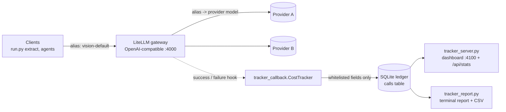

# LLM usage and cost tracker

A LiteLLM callback that writes one row per model call into a local SQLite ledger,
a FastAPI dashboard and a report CLI over that ledger, and a mock-traffic demo that
needs no API keys. It sits behind the project's self-hosted gateway, so every model
call is metered no matter which alias or provider served it.



## What is recorded

| Column | Meaning |
|---|---|
| `ts_utc`, `status` | when, and `success` or `failure` |
| `alias` | the gateway model group the client asked for (`vision-default`) |
| `provider`, `provider_model` | what actually served the call (`openai/mock-vision-model`) |
| `call_type` | e.g. `acompletion` |
| `input_tokens`, `cached_tokens`, `output_tokens`, `total_tokens` | from the response's usage, accepting both common usage shapes |
| `response_cost_usd` | LiteLLM's own estimate from its price map. It may be `0` or missing for models it doesn't know |
| `benchmark_cost_usd` | computed here from a local price table (env defaults, or `TRACKER_PRICES_FILE` per model/alias), so costs stay comparable across providers |
| `latency_ms` | end time minus start time, or LiteLLM's reported response time |
| `error_type` | exception class name for failures, e.g. `InternalServerError` |

## What is never recorded

Prompt and response text, prompt hashes, user ids, session ids, API keys, API base
URLs, request headers, error messages, and LiteLLM's raw `standard_logging_object`.

This matters because LiteLLM's logging payload includes the full messages, and its
error strings can echo prompt content. The tracker copies only the fields in the
table above. Tests feed it secrets through every one of those channels and then check
that none of them appear anywhere in the database **file**.

Opening a ledger created by the original version, which had `prompt_preview`,
`prompt_sha256`, `raw_meta_json` and `call_id` columns, migrates it in place. Token
and cost history is kept, and the file is rebuilt with `secure_delete` and `VACUUM`,
so the old prompt text is physically gone, not just hidden.

## Dashboard and report

- **Totals:** calls, failures and error rate, input/cached/output tokens, cache share,
  estimated spend, and how much of it LiteLLM could price itself.
- **Budget:** remaining budget and an over-budget flag (`TRACKER_BUDGET_USD`). This is a
  display threshold, not an enforced limit.
- **Spend rate:** an observed rate over calls that finished in the last 60 seconds.
- **Per alias and provider model:** calls, failures, tokens, cost, and p50/p95 latency.

## Try it (no keys, no network)

```bash
pip install -e ".[gateway]"
python gateway/demo_traffic.py               # mock traffic through a real LiteLLM Router
TRACKER_DB_PATH=gateway/demo_tracker.db python gateway/tracker_server.py   # http://127.0.0.1:4100
python gateway/tracker_report.py --db gateway/demo_tracker.db --csv by_alias.csv
```

`demo_traffic.py` sends calls to two aliases backed by two mock models, plus two forced
failures, and prints a report like this (latencies vary by machine):

```
calls 14  (failures 2, error rate 14.3%)
tokens  input 120  cached 0 (0.0%)  output 240
estimated cost $0.002640  (budget $50.00, remaining $50.00)

alias           provider model               calls  fail        in       out      cost $      p50      p95
vision-default  openai/mock-vision-model        10     2        80       160    0.001760    14 ms  2530 ms
cheap-text      openai/mock-text-model           4     0        40        80    0.000880    14 ms    48 ms
```

## Use it with real traffic

```bash
cp gateway/litellm_config.example.yaml gateway/litellm_config.yaml   # your aliases and providers
cp .env.example .env                                                  # your keys (git-ignored)
python gateway/start_gateway.py                                       # LiteLLM on :4000 + tracker
python gateway/tracker_server.py                                      # dashboard on :4100
```

The config registers `tracker_callback.tracker_handler_instance`. Creating that instance
doesn't touch the disk. The ledger is created on the first call.

## Original version vs. portfolio improvements

**Original (built during the project, Sep 2026):**
- A LiteLLM `CustomLogger` callback writing to SQLite under a thread lock.
- Token counts (input, cached, output, total), latency, LiteLLM's reported cost, and a
  local benchmark cost from one environment price table.
- A FastAPI dashboard with totals, a 60-second spend rate, a budget figure and the last
  25 calls.
- A launcher that registered the callback, and a gateway config with model aliases.
- Separate scripts that rebuilt a cost ledger from agent session logs
  (`cost_analysis/build_cost_ledger.py`).

**Defects found while preparing the portfolio, all now fixed and tested:**

| Defect in the original | Effect | Test |
|---|---|---|
| `async_log_success_event` was indented outside the class | The proxy only calls async hooks, so production traffic was never recorded. The live ledger held one manual test row | `test_async_hooks_are_methods_of_the_class`, LiteLLM integration tests |
| The alias came from `kwargs["model"]` | LiteLLM puts the *provider* model there, so the alias was never recorded and "provider model" was always empty | `test_alias_is_the_model_group_not_the_provider_model` |
| The 60-second window compared ISO timestamps with SQLite `datetime()` text | `'T' > ' '`, so every row from the same day counted as "last 60 seconds" | `test_rate_window_excludes_older_rows` |
| Stored a 1,000-character prompt preview, a prompt hash, and user/session/api_base metadata | Document contents and identifiers ended up in a local file | `test_no_prompt_credentials_session_or_metadata_reach_the_ledger` |
| Failures were not tracked | Error rates and failed spend were invisible | `test_failure_row_keeps_only_the_exception_type` |
| Launcher hard-coded absolute paths and read a key file directly | Not portable, and it encouraged keys on disk | `gateway/start_gateway.py` reads the environment |

**Added for the portfolio (Oct 2026):**
- Correct alias, provider and provider-model capture, verified against a real LiteLLM Router.
- Failure rows with the error type only.
- The privacy whitelist, plus migration and physical purge of old ledgers.
- A per-model/per-alias price table.
- Dashboard breakdown by alias with p50/p95 latency, error rate, cache share, an
  over-budget flag, and pricing coverage.
- The report CLI with CSV export.
- The keyless mock-traffic demo.
- 25 unit tests and 3 integration tests that drive real LiteLLM in CI.

## Limits

- Costs are estimates from price tables; provider invoices are the source of truth.
- The tracker has been exercised with mock traffic and tests, not yet under sustained
  production load.
- SQLite with a process-wide lock suits one gateway process; several gateway replicas
  would need a shared database.
- Budget is shown, not enforced. LiteLLM's own budget features would be the place to
  enforce one.
